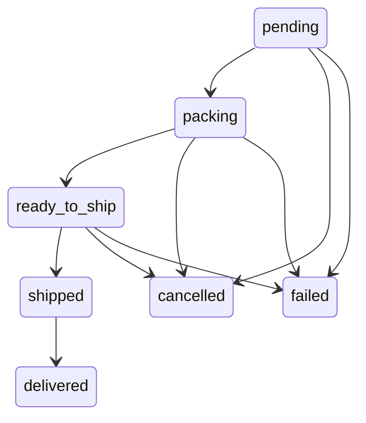

# Phase C2 — Physical Commerce MVP

Branch: `feature/v3-c2-physical-commerce`. This implements the physical MVP in the [V3 master](sellerbottel-v3-master.md), on top of [C1](PHASE_C1_COMMERCE_FOUNDATION.md). Physical sales are storefront-first. Existing digital inventory, service, wallet, coupon, bot and QRIS transport contracts remain in place.

## Products and variants

New products use `fulfillment_type=physical`, `product_kind=physical`, `requires_shipping=true`, `delivery_type=manual_shipping`. `physical_profile` contains `has_variants`, default weight/dimensions and `shipping_enabled=true`. Authoring uses dedicated additive JSON APIs, so C1's generic inactive-future-type authoring contract remains compatible. No legacy product backfill runs.

Every physical product requires an active variant for sale. Products without customer choices use one variant with empty options. Variants live in the tenant database's `physical_variants`: product ID, stable SKU, optional barcode, generic `option_values`, nullable IDR price override, weight in grams, dimensions in centimeters, active flag and timestamps. Option names are arbitrary; color and size are examples. Historical variants/products are deactivated rather than deleted.

SKU uses uppercase ASCII normalization, 1–64 characters, starting with a letter/digit and allowing letters, digits, dot, underscore and hyphen. A unique `sku` index applies to the whole tenant collection. SKU is immutable and remains reserved after deactivation. Separate tenants may use the same SKU. Stock fields cannot be set through variant editing.

## Atomic stock and append-only ledger

Digital credentials continue to use `inventory_items`. Physical stock uses `on_hand`, `reserved`, `available=on_hand-reserved`, `stock_version`, and an embedded append-only `stock_events` journal. The journal is authoritative; counters and each event change together in one Mongo document compare-and-swap. This works on the dedicated standalone Mongo without requiring replica-set transactions.

`stock_movements` is an immutable, idempotent projection of that journal. Movement IDs are UUID5 of database, variant, type and operation reference. Projection only uses `$setOnInsert`. A failed projection leaves the committed journal/counters intact; retry, variant stock reads and owner ledger reads repair it without applying quantity changes again. Across variants, checkout uses the existing compensating saga rather than claiming a multi-document transaction.

| Type | On hand delta | Reserved delta | Reference |
|---|---:|---:|---|
| RECEIVE | +quantity | 0 | Unique admin operation |
| DAMAGE | −quantity | 0 | Unique admin operation |
| ADJUSTMENT | signed quantity | 0 | Unique admin operation |
| RESERVATION | 0 | +quantity | Immutable order line ID |
| SALE | −quantity | −quantity | Matching reservation |
| RELEASE | 0 | −quantity | Matching reservation |
| RETURN | +quantity | 0 | Matching consumed sale |

Each event includes variant ID, SKU, type, quantity, counter deltas, reference type/ID, reason, actor and timestamp. Counters must satisfy `on_hand >= reserved >= 0` before the CAS. Reservations also atomically require an active variant. SALE/RELEASE require an outstanding reservation of the exact quantity; RETURN requires an exact-quantity SALE. Duplicate operation references return the original event; conflicting quantities fail. RECEIVE/ADJUSTMENT/DAMAGE require an owner reason. The UI keeps a reference stable across an uncertain stock request retry.

The MVP journal has a deliberate capacity guard: new admin movements/reservations stop at 3,000 events per variant; pending SALE/RELEASE/RETURN remain allowed. This leaves space for outstanding compensation below Mongo's document limit. Journal archival and scalable ledger projection are follow-up work. Do not clear or edit historical events to bypass the guard.

## Checkout, addresses and pricing

Cart identity is `(product_id, variant_id)`. Exact duplicate rows merge; different variants remain distinct. Variant activity, ownership and availability are revalidated server-side. Missing products fail web checkout rather than silently dropping a mixed-cart item. A single digital/service/physical cart produces one order, one payment and separate C1 fulfillment records.

Physical lines snapshot product/name, variant ID, SKU, option values/label, quantity, unit price, subtotal, weight and dimensions. Existing C1 line IDs and fulfillment snapshots remain authoritative after product/variant edits. Physical stock reserves before payment finalization and consumes into SALE once paid; unpaid expiry/cancellation/failure releases it. Wallet initialization failures use existing compensation/refund behavior. Paid pre-shipment cancellation records RETURN and preserves the SALE history; financial refunds remain outside the physical workflow.

A physical or mixed checkout requires recipient name, phone, main address, city/regency, province and postal code. The manual form also accepts an extra address line, district, country and notes. Country defaults to `ID`; Indonesian postal codes require five digits. Customer profile addresses live in the selected tenant database, may be saved explicitly, and are copied into the order. Later profile edits do not change shipment addresses. Digital/service-only carts require no shipping address.

Manual shipping uses one tenant flat IDR fee, configured in tenant settings as `manual_shipping_fee`, default 0. It is charged once per order containing physical goods, irrespective of line count, weight or address. It is visible in the quote and stored on the order. No courier lookup occurs. Product discounts/coupons continue to apply to eligible merchandise, excluding shipping.

Pricing preserves existing rounding and QRIS fees. `items_subtotal` is merchandise before discounts, `items_total` is after discounts, `shipping_fee` is separate, tax is 0, and `grand_total=items_subtotal-discount_total+shipping_fee+tax+payment_fee`. Balance has payment fee 0. QRIS keeps its existing percentage fee and unique payment code: `total` is merchandise plus shipping, `grand_total` adds the payment fee, and `payment_amount` also includes the separate unique code.

## Physical fulfillment and recovery

C1's physical adapter initializes a durable physical record to pending without running digital delivery. The owner then operates the validated workflow:

States cannot be skipped. Shipment actions require an actually paid order and a completed initialization claim. `shipped` requires a manually entered carrier and tracking number, with bounded lengths and no control characters. Repeated identical transitions are idempotent; contradictory tracking on a repeated shipped request fails. Cancellation/failure is blocked after shipment.

The fulfillment record contains the authoritative `shipment_snapshot`, atomically written with state. `shipments` has one record per fulfillment, with carrier, tracking, shipped/delivered dates and status. Its projection can be repaired by repeating the state or fetching owner order detail, and an older shipped projection cannot overwrite delivered. Cancellation records `stock_compensation_pending` before reversing stock; repeat/detail access repairs an interrupted compensation.

A provider-free worker scans physical storefront QRIS orders every 30 seconds across provisioned tenant databases, including suspended/disabled tenants, without depending on a configured bot or enabled payment monitor. Lifecycle blocks new sales while existing reservations may expire. The worker does not send Telegram/email or query providers. QRIS expiry records `stock_release_pending` atomically with expired state. A later expiry pass retries unfinished release. The existing legacy quantity-stock compensation also receives an atomic per-order-line reference on the product, preventing duplicate restock when a mixed cancellation/release is retried.

A paid web order whose initialization failed remains auditable as `delivery_failed`. The owner can explicitly recover initialization through `/physical/orders/{oid}/recover` and the order UI. It ensures missing records, idempotently consumes stock/commits reserved digital items and uses durable C1 claims. Failed/running/ambiguous delivery claims cannot be blindly replayed. Repeated payment notifications do not re-debit or re-consume. Automated physical refunds are blocked in the legacy refund endpoint; manual financial handling is deferred to R1/payment phases.

Global order status is `physical_pending` for pending physical-only/digital+physical shipments and `service_waiting` while services are queued. Completing a service retains physical pending status. The order becomes delivered only when all records are delivered/completed. Delivered digital lines of mixed orders remain available through the private customer delivery API while physical shipment waits. Carrier/tracking is shown separately in customer order detail.

## Tenant isolation and APIs

All owner operations derive their tenant database from the verified owner session and recheck lifecycle. Customer `/api/store/` APIs bind the registered host or validated `/t/{slug}` selector before authentication, quote, checkout and history. Conflicting registered host/path selectors fail. Customer JWTs include the registry tenant ID; even identical customer IDs cannot authenticate in another tenant. Path storefront links, cart storage and image URLs preserve the selected tenant. Suspended/disabled tenants cannot transact.

| API under `/api/public/tenant/full/physical` | Purpose |
|---|---|
| POST `/products`, PUT `/products/{pid}` | Physical profile authoring |
| POST `/products/{pid}/image` | Existing primary-image infrastructure |
| GET/POST `/products/{pid}/variants` | List/add variants |
| PUT `/variants/{vid}` | Edit/deactivate; immutable SKU |
| POST `/variants/{vid}/stock` | RECEIVE/ADJUSTMENT/DAMAGE |
| GET `/variants/{vid}/stock-movements` | Repair/read tenant ledger |
| GET/PUT `/shipping` | Flat shipping settings |
| GET `/orders/{oid}` | Address, lines, physical states and repair |
| POST `/orders/{oid}/fulfillments/{fid}` | Validated shipment action |
| POST `/orders/{oid}/recover` | Explicit paid initialization recovery |

Customer APIs add GET/PUT `/api/store/address`, GET `/orders/{oid}/shipping` and POST `/orders/{oid}/cancel` for unpaid physical orders. Existing quote/checkout/history APIs gain additive physical fields and tenant path aliases. No owner/platform URL is used by tenant UI.

## Verification and deferred scope

See the [C2 audit](../audits/phase-c2-physical-commerce-20261008.md) and `tools/validate_c2_live.py`. Tests cover stock journal projection failure, order insert failure after reservation, fulfillment insert failure after payment, expiry outage recovery, shipment projection failure, immutable snapshots, generic options, coupons, mixed delivery and identical IDs across tenant databases. Real acceptance uses fresh isolated databases on development port 27019 and local runtimes 8004/3004. SMTP/Telegram/payment transports are absent or mocked; production and original `.env` are untouched.

Telegram physical checkout is blocked before charging. Existing digital/service bot flows remain operational. Subscription and manual-digital fulfillment remain C1 placeholders. Payment Core P1, Settlement IDSE P2, tenant gateways P3, automated shipping S1, returns/refunds R1, branding B1, multiple product images, warehouses and journal archival are deferred.
